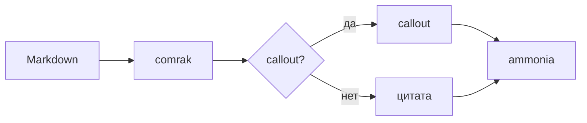
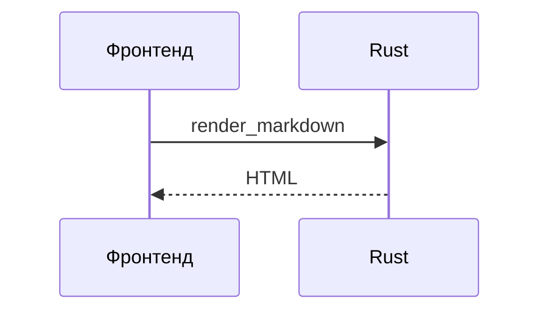

# Витрина режима чтения

Эталонный документ для проверки режима чтения (Ctrl+E). YAML-шапка выше не
должна быть видна.

## Текст

Обычный текст, *курсив*, **жирный**, ~~зачёркнутый~~, ==выделенный== и
`строчный код`. Клавиши: <kbd>Ctrl</kbd>+<kbd>E</kbd>.

Ссылки: [внешняя](https://tauri.app), [соседний файл](other.md),
[к формулам](#формулы) и автоссылка https://github.com.

## Списки

1. Первый
2. Второй
   - вложенный
   - ещё один
3. Третий

- [x] сделано
- [ ] не сделано

## Таблица

| Слева | По центру | Справа |
|:------|:---------:|-------:|
| а     |     б     |      в |
| длинная ячейка | `код` | **1 234** |

## Цитата и callouts

> Обычная цитата остаётся цитатой.

> [!note]
> Callout без заголовка: заголовок — имя типа.

> [!tip] Совет с **разметкой** в заголовке
> Содержимое callout со списком:
> - пункт один
> - пункт два

> [!warning]- Свёрнутый по умолчанию
> Этот текст виден после клика по заголовку.

> [!success]+ Развёрнутый, но сворачиваемый
> Можно свернуть кликом по заголовку.

> [!question] Вложенный callout
> Внешний текст.
>
> > [!example] Пример внутри
> > Вложенный callout с `кодом`.

> [!tldr] Синоним abstract
> Оформлен как abstract.

> [!error] Синоним danger
> Оформлен как danger.

> [!мой-тип] Незнакомый тип
> Выглядит как note.

## Код

```rust
fn main() {
    let greeting = "Привет из Rust";
    println!("{greeting}");
}
```

```typescript
const answer: number = 42;
console.log(`answer = ${answer}`);
```

## Формулы

Строчная формула $E = mc^2$ и блочная:

$$
\int_0^\infty e^{-x^2}\,dx = \frac{\sqrt{\pi}}{2}
$$

```math
\sum_{n=1}^{\infty} \frac{1}{n^2} = \frac{\pi^2}{6}
```

Ошибка в формуле не ломает документ: $\frac{1}{$.

## Диаграммы





Диаграмма с ошибкой показывает сообщение вместо картинки:

```mermaid
flowchart LR
    A --> 
```

## Картинка

Локальная картинка рядом с файлом:


## Сноски

Текст со сноской[^1].

[^1]: Текст сноски.

## Безопасность

Ниже попытки выполнить код. Ни одна не должна сработать, а в разметке не
должно остаться ни `script`, ни `onerror`, ни `javascript:`.

<script>document.title = "XSS через script"</script>


[ссылка-ловушка](javascript:document.title='XSS через ссылку')

<details>
<summary>Обычный HTML-блок details</summary>

Работает без скриптов.

</details>
